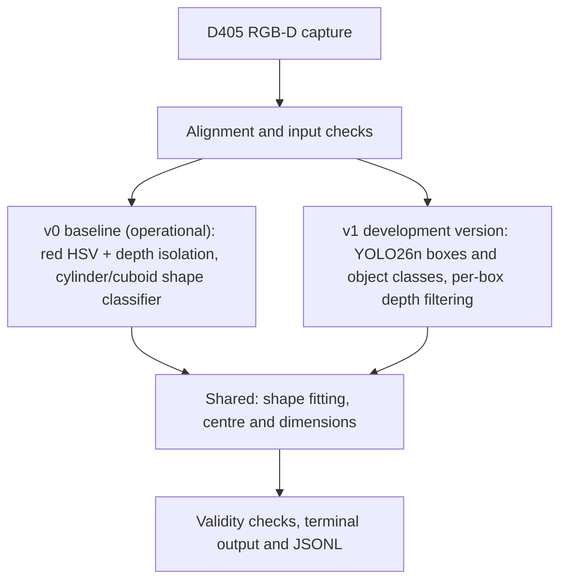

# Design Solution Definition: Computer Vision Subsystem

> **Project:** N-Pulse · **Document ID:** DSD-001-CV
> **Academic year:** 2026-2027 · **Team:** Computer Vision
> **Version:** 1.2.1 · **Status:** In Review
> **Project phase:** Proof of Concept · **Last modified:** 2026-10-25
> **Repository path:** `docs/design/2026-2027/computer-vision/README.md`

## Document control

### Roles and sign-off

| Role | Name | Affiliation / handle | Date | Signature / review link |
|---|---|---|---|---|
| Author(s) | Haobin, Melvyn, Douaa, Yanis, Zéphir | N-Pulse CV team | 2026-10-25 | Prepared for review |
| Reviewer (technical) | To be assigned | Technical review | Pending | Pending |
| Concurrence (SE reviewer) | Santiago | Systems Engineering | Pending | Pending |
| Concurrence (QM reviewer) | To be assigned | Quality Management | Pending | Pending |
| Approval | Project Manager | N-Pulse | Pending | Pending |

The document ID and CV requirement IDs are local identifiers pending project mapping. Review and approval links will be added after the PR is created; no approval is implied by this version.

### Modification log

| Version | Date | Author(s) | Main changes | PR / commit |
|---|---|---|---|---|
| 1.2.1 | 2026-10-25 | CV team | GitHub Markdown structure, traceability and latest local-test status | Pending |
| 1.2.0 | 2026-10-24 | CV team | Concise review edition | Local draft |

## Table of contents

1. [Introduction](#1-introduction)
2. [Requirements and traceability](#2-requirements-and-traceability)
3. [Concept justification](#3-concept-justification)
4. [Traded-off concepts](#4-traded-off-concepts)
5. [Quality management and compliance](#5-quality-management-and-compliance)
6. [Licensing](#6-licensing)
7. [Open issues and future work](#7-open-issues-and-future-work)
8. [References](#8-references)
9. [Appendices](#9-appendices)

## 1. Introduction

### 1.1 Purpose and scope

This Design Solution Definition (DSD) is at a Proof of Concept stage, prepared for review on 2026-10-25; validation is pending. It justifies the concept selected for the Computer Vision subsystem. It covers the technical problem, retained architecture, alternatives, and quality/risk implications. The subsystem shall recognize supported everyday objects and estimate their geometric shape, centre and dimensions using a chest-mounted RealSense D405 and an Arduino UNO Q with 4 GB RAM.

The semester demonstration shall use stationary targets and a wearer standing still, under normal indoor lighting, with ordinary backgrounds and limited clutter. Targets shall be fully visible, separated and non-transparent. The intended distance is 50 cm-1 m; the team reports this range as tested usable, with quantitative evidence still to attach.

**Out of scope:** battery operation, final ARM/Firmware integration, robot control, full grasp-pose planning, occlusion handling, moving-target perception, persistent tracking and a graphical interface. A computer may supply power and display logs; all main CV processing shall run on UNO Q.

### 1.2 Responsibility and change authority

- **Document owner:** Haobin / CV team.
- **Change authority:** project management, with Santiago/SE review for scope, requirements and interfaces.
- **Change process:** propose changes by issue or PR, link evidence and affected requirements, and update this document after review.

### 1.3 Abbreviated terms and definitions

- **RGB-D:** colour image with depth data.
- **ONNX:** model format selected for embedded inference.
- **Object centre:** centre estimated from a fitted geometric primitive, not the visible point-cloud centroid.
- **Camera frame:** +X right, +Y down, +Z forward; output units are mm.
- **Baseline (v0):** existing complete red-object pipeline (HSV + depth isolation, shape classifier, primitive fitting); operational in real time on a live D405 and used as reference.
- **Development version (v1):** colour-independent multi-class detector replacing the v0 isolation and classification stages; in development while the D405 dataset is being built.

## 2. Requirements and traceability

Local CV requirement IDs will be mapped to the project requirements with SE. “Shall” denotes a requirement. “Should” denotes a recommendation and “may” an option. Methods: T = test, D = demonstration, I = inspection, M = measurement, A = analysis. Scope follows [R1](#8-references) with the team-confirmed changes in this document.

| Requirement ID | Requirement | Verification method | Status |
|---|---|---|---|
| CV-REQ-001 | Shall acquire RGB and depth with documented alignment and intrinsics | T/I: Check streams, intrinsics, units and alignment | computer capture and saving reported stable; board validation pending |
| CV-REQ-002 | Shall recognize can, bottle, box, ball, pen/pencil (one class), and lever-style door handle, in multiple colours | T: Evaluate labelled held-out scenes by class | v0: red objects only, shape (cylinder/cuboid) instead of semantic class. v1: 4/6 classes trained on Open Images (iter1 val mAP50 0.574); pen_pencil and door_handle annotated in the D405 dataset, included in the next training run; D405 evaluation pending |
| CV-REQ-003 | Shall process at least two separated objects, including two of the same class, with independent associated point clouds | T: Test two separated objects, including same-class pairs | Point-cloud code passed local tests; test scope and two-object integration evidence pending |
| CV-REQ-004 | Shall estimate shape-fitted geometric centre in camera coordinates | M/T: Compare centre against independent measurements | Geometric-centre definition agreed. v0 fits on real D405 frames; 3 hand-held trials overestimated width by 7-29 mm. Independent centre measurement at 50 cm-1 m pending |
| CV-REQ-005 | Shall run the complete main pipeline on UNO Q | D/T: Demonstrate all stages on UNO Q; computer power/logs only | board ordered, not yet received |
| CV-REQ-006 | Shall display and save class, shape, dimensions, centre, confidence and validity with frame metadata | I/T: Inspect terminal and per-frame JSONL fields and units | terminal and board-local JSONL; adapter verification pending |
| CV-REQ-007 | Shall report missing/invalid results explicitly; never present old coordinates as current | T: Inject missing targets, invalid fits and camera loss | no-object, fit failure and camera-loss tests planned |
| CV-REQ-008 | Shall meet SE-agreed accuracy, latency, coverage and sustained-run targets at 50 cm-1 m | M/T: Measure baseline, then test against SE-agreed targets | v0: 40-60 ms/frame with a live D405 on a laptop CPU (not UNO Q). First measure baseline at 50 cm-1 m, then agree numerical targets |
| CV-REQ-009 | Shall maintain reliable power and USB capture | T/M: Measure power/load; test USB capture and reconnect | wiring, hub and power tests pending |
| CV-REQ-010 | Shall support repeatable evaluation with versioned data, model and configuration | I/T: Replay versioned data and compare repeat runs | historical replay tools exist; current evaluation pending |
| CV-REQ-011 | Shall demonstrate chest-mounted wearable operation | D/I: Inspect mount and demonstrate stationary wearable use | preliminary mount/enclosure designs exist; physical verification pending |

## 3. Concept justification

### 3.1 Solution overview

The pipeline first identifies each object's semantic class, then uses depth to extract its point cloud and fit a geometric approximation. Semantic labels and geometric labels remain separate.

Two versions share the same geometric back-end: a complete baseline (v0) that already runs in real time, and a development version (v1) that replaces only its front-end (isolation and classification).



*Figure 3.1: Baseline and development-version pipelines. v0 runs end to end; v1 is not yet integrated with the shared fitting stage.*

#### 3.1.1 Baseline (v0): complete pipeline, operational in real time

- **What it is:** red HSV + depth isolation, YOLOv8n-cls shape classifier (cylinder vs cuboid), primitive fitting, centre and dimensions.
- **Demonstrated:** runs end to end on a live D405 (laptop, Windows, CPU) at about 40-60 ms per frame [R4].
- **Measured:** shape correct in 3/3 trials; width overestimated by 7-29 mm. Trials used a hand-held camera at 10-37 cm, below the 50 cm-1 m target range [R4].
- **Limitations:** red objects only; two shapes; shape instead of semantic class.
- **Role:** measured reference, regression test and demonstration fallback.

#### 3.1.2 Development version (v1): multi-class detector, D405 dataset being built

- **What it is:** YOLO26n detector (boxes and classes, COCO-pretrained, imgsz 416), colour-independent. It replaces the v0 isolation and classification and reuses the v0 fitting stage.
- **Done:** first training (iter1) on an Open Images V7 subset, 4 classes (ball, can, box, bottle): val mAP50 0.574, mAP50-95 0.388; test mAP50 0.522, information only [R5]. Main error: missed objects (recall 0.47-0.49 on val for can, box and bottle).
- **In progress:** D405 dataset collection and annotation for the six classes (all six already annotated), then retraining with pen_pencil and door_handle added.
- **Pending:** D405 live tests, integration with the fitting stage, ONNX export.
- **Replacement criterion:** v1 replaces v0 only when it performs at least as well on the same D405 scenes.

#### 3.1.3 Common status

D405 capture/saving on a computer is reported stable. Point-cloud-related code has been written and has passed local tests, as reported by the team. The complete required pipeline (v1 front-end with the shared fitting stage) is not yet integrated/demonstrated. The local test scope and inputs remain to be documented; these results do not establish real D405 end-to-end accuracy or UNO Q operation. UNO Q is ordered; as of 2026-10-25 it has not been received and deployment has not started. Delivery is tentatively expected during 2026-10-26 to 2026-11-01; the date is unconfirmed.

### 3.2 Main design choices

#### 3.2.1 Sensing and embedded platform

- **Decision:** chest-mounted D405 and UNO Q 4 GB Linux; deploy the model through ONNX.
- **Rationale:** available camera/code, lightweight integration, and project/team cost and resource priorities. Lower future battery burden is a design motivation, not a measured comparison.
- **Requirements addressed:** CV-REQ-001, 005, 008, 009, 011.
- **Consequences:** all main computation stays on UNO Q; computer power/log viewing is allowed. USB, camera bindings and performance need board tests. If necessary, simplify the model/algorithms first.

#### 3.2.2 Recognition and per-object depth processing

- **Decision:** replace the v0 front-end with the v1 YOLO26n detector (see 3.1.1 and 3.1.2). Filter background/table points per box and associate an independent point cloud with each instance. Keep the v0 fitting stage, and keep v0 as reference and demonstration fallback.
- **Rationale:** multi-colour targets rule out red-only isolation as the sole extraction method. Detection rather than segmentation: box labels are cheaper to produce, and detection models are expected to be smaller and faster on the UNO Q CPU (not yet measured). The YOLO26n head needs no NMS step, which simplifies ONNX export. Reusing the v0 fitting stage keeps geometry that already runs on real D405 frames.
- **Model choice and UNO Q fit:** YOLO26n is the smallest current YOLO detector, chosen because the UNO Q has no GPU (CPU only, 4 GB RAM). The model is about 5 MB and the board software about 430 MB [R3], so a large margin is expected; memory use during inference will be measured when the board arrives (OI-06).
- **Requirements addressed:** CV-REQ-002, 003, 004, 006.
- **Consequences:** the current v1 live test estimates position from the median depth of the central part of each box: this is a visible-surface point, not the fitted centre required by CV-REQ-004. Box crops may include table/background points; masks remain the fallback if per-box filtering is insufficient. Same-class association and geometric accuracy require integration tests.

#### 3.2.3 Data and geometry definitions

- **Decision:** start from an Open Images V7 subset (Ball, Tin can, Box, Bottle; about 500 images per class), then fine-tune on self-collected/annotated D405 data; split self-collected data by complete capture session. Fit cylinder, cuboid or sphere, otherwise report unknown.
- **Rationale:** Open Images allows training before the D405 dataset is ready. It is split randomly 70/15/15 (seed 0, test split frozen) because it has no capture sessions; model choices use the validation split only. Session grouping reduces adjacent-frame leakage in D405 data; simple primitives provide interpretable centre and dimension estimates.
- **Requirements addressed:** CV-REQ-002, 004, 006, 007, 010.
- **Consequences:** the D405 dataset is being built, and all six classes are already annotated. The first training run (iter1) used the four classes available in the Open Images subset; pen_pencil and door_handle enter at the next training run on the D405 dataset. D405 counts are still to attach. Class-to-shape mapping: can and bottle use cylinder, box uses cuboid, ball uses sphere; v0 has no sphere fitter yet. Cubes use cuboid and rods use cylinder. Bottles use the body only (no neck/cap); door handles use the graspable lever only (no base/plate). Required lever-shape coverage remains open for SDR advice.

#### 3.2.4 Geometry outputs

| Shape | Dimensions in mm | Position |
|---|---|---|
| Cuboid | Local edge lengths sorted: length >= width >= height | Fitted geometric centre |
| Cylinder | Diameter and axial length | Fitted geometric centre |
| Sphere | Diameter | Fitted centre |
| Unknown / unreliable fit | null | x/y/z = null; valid = false |

Retain a recognized semantic class even when geometry is invalid. Confidence describes semantic recognition only and is null if unavailable.

#### 3.2.5 Operating modes

| Mode / stage | Purpose | Entry condition | Exit condition | Active components |
|---|---|---|---|---|
| Initialization | Check resources/configuration | Program start | Ready or fault | Camera/model loaders, logging |
| Calibration | Check alignment and geometry | Setup or mount changes | Accepted calibration | Camera, calibration tools |
| Nominal | Produce current results | Valid fresh input | Stop or fault | Full CV pipeline |
| Replay / simulation | Repeatable development | Explicit test source | End of data or stop | Test source, pipeline, logs |
| Fault | Report invalid perception | Camera/input/runtime failure | Operator resolves fault and restarts | Status output and diagnostics |

No target produces `no_object` and an empty object list. Camera loss produces `camera_error`, an empty list and a terminal message. Never reuse old coordinates. Manual restart is acceptable; test sources must be labelled.

### 3.3 Functionally linked systems

Mechanical supports the chest mount and enclosure; Electronics supports power and USB validation. The computer powers UNO Q; D405 connects to UNO Q for data. Exact hub/cabling is unverified. Final ARM/Firmware transport and camera-to-arm transformation are deferred.

### 3.4 Performance budgets and design margins

| Budget / metric | Planned assessment | Target / status |
|---|---|---|
| Recognition, shape, centre and dimensions | Held-out scenes; known objects and independently measured centres | First points: v0 width +7 to +29 mm (3 hand-held trials, 10-37 cm); v1 val mAP50 0.574 on Open Images. D405 baseline at 50 cm-1 m pending; targets agreed with SE afterwards |
| Latency, FPS and valid-output rate | Timestamped complete pipeline at 50 cm-1 m | v0: 40-60 ms/frame on a laptop CPU. Board tests pending |
| Compute / memory | Peak use within the 4 GB board configuration | Actual usable/application budget pending |
| Power / temperature / mass | Complete board, camera, hub and wearable assembly | Measurements and limits pending |
| Stability | Continuous run, USB faults and recovery | Duration/limits to agree with SE | First establish a baseline, then agree thresholds with Santiago/SE before acceptance testing. No numerical performance margin is claimed yet.

Use known-size regular objects and a fixed camera, independently measuring their camera-relative centres. Record setup, lighting, distances, configuration and measurement uncertainty. Fixed-rig tests do not replace the wearable demonstration.

## 4. Traded-off concepts

### 4.1 Trade-off method

Compare functional fit, local deployment feasibility, robustness, computing resources, integration/maintenance, and cost/procurement. Mandatory requirements are feasibility gates; they cannot be offset by a higher score elsewhere. The current assessment is qualitative. Weights and numerical scores will be established when comparative evidence is available.

### 4.2 Traded-off design choices

| Choice | Advantages | Limitations and decision |
|---|---|---|
| UNO Q + lightweight model + geometry | Matches team direction; reuses code; focuses on required output | Camera/runtime/resources unverified. Retained; optimize before changing platform |
| Jetson complete system | Alternative for more demanding processing | Different procurement and integration burden. Not selected; no measured comparison claimed |
| Remote GPU / GraspNet | Enables heavier grasp-planning experiments | Network dependence conflicts with local computation; full grasp pose outside core scope. Not retained |
| v0 red HSV pipeline (baseline) | Operational on a live D405 at 40-60 ms/frame; measured; same fitting stage as v1; includes a geometry-only classifier for debugging | Red objects only; shape instead of semantic class; width overestimated in real trials. Retained as reference, regression test and demonstration fallback; not the final concept |
| Detection model (YOLO26n) versus segmentation model (YOLO-seg) | Detection: cheaper box labels, smaller and faster model, simpler export | Segmentation gives object masks at higher labelling and inference cost. Detection retained; segmentation workflow kept as an alternative |
| D405 versus D415 | D405 available, existing code support, lightweight design direction | Final choice is D405; quantitative range/error evidence to attach |
| Boxes + depth versus mask-based extraction | Boxes reuse current model outputs and allow geometric filtering | Background contamination and same-class association need testing. Boxes + depth retained; masks remain an alternative for expert feedback |

### 4.3 Trade-off summary

Retain D405 + UNO Q + ONNX, using YOLO26n class/box outputs (v1) and depth-based geometry shared with v0. Keep v0 as the measured reference until v1 matches it on the same D405 scenes. The main unresolved trade-off is whether box-based extraction gives sufficient geometry quality on the embedded budget. No unsupported scores or completed hardware qualification are claimed.

## 5. Quality management and compliance

The template's project-level QM framework is not finalized, and the team has not received unified instructions. Meanwhile, record code/model/data versions, reviews and test conditions. Test invalid depth, missing targets, stale results and camera loss explicitly. Formal applicability and compliance decisions remain with project SE/QM.

## 6. Licensing

Project licensing guidance is pending. Record licenses and sources for software, weights and datasets before redistribution. The public dataset is Open Images V7: its annotations are CC BY 4.0, and its images are listed as CC BY 2.0 without verification by Google, so image-level licences must be checked before redistribution. No final project license or compliance claim is assigned here.

## 7. Open issues and future work

| ID | Issue / next step | Owner | Due / gate | Impact if unresolved |
|---|---|---|---|---|
| OI-02 | Confirm official requirement mapping/review roles | Haobin + Santiago | Project review | Incomplete traceability |
| OI-03 | Attach mount/range evidence; validate chest geometry | Zéphir; Douaa + Melvyn | Before wearable acceptance | Unverified view/range |
| OI-04 | Define fit thresholds, lever geometry and replay/fault timing | Haobin + SE | Before interface acceptance | Ambiguous validity/geometry |
| OI-05 | Measure baseline and agree numerical targets | Douaa + Melvyn; Santiago | Before acceptance tests | No quantitative pass/fail |
| OI-06 | Receive board; test current-model ONNX and camera runtime | Haobin + Yanis | After board arrival | Embedded feasibility unverified |
| OI-07 | Integrate locally tested point-cloud code with recognition and fitting | Haobin, interim | Before end-to-end demonstration | Complete pipeline unavailable |
| OI-08 | Confirm hub/cables/power and enclosure | Zéphir + Electronics/Mechanical | Before wearable tests | Unstable capture or mounting |
| OI-09 | Attach dataset identity, counts, splits and reference-test procedure | Yanis + Douaa; Melvyn | Before reported evaluation | Results not reproducible |
| OI-10 | Resolve project QM and source/data licenses | Haobin + project QM | Before approval/release | Review/redistribution unresolved |
| OI-11 | Implement terminal/JSONL output and verify faults | Haobin, interim | Before interface tests | Output contract unverified |
| OI-12 | Run the range test (`tools/distance_test.py`) at 50 cm-1 m with a fixed camera, v0 first, then v1 | To be assigned | Before SE target agreement | Baseline outside the required range |
| OI-13 | Train v1 on the D405 dataset (all six classes) and compare it with v0 on the same scenes | To be assigned | Before replacing v0 | v1 benefit unproven |
| OI-14 | Export v1 to ONNX and check parity with the PyTorch model | To be assigned | Before board tests | Embedded model unverified |
| OI-15 | Add a sphere fitter; explain v0 width overestimation | To be assigned | Before geometry acceptance | Ball geometry missing; oversized dimensions |

Calendar dates for implementation gates are not yet agreed. OI-01 (semester scope) is closed: battery and final ARM/Firmware integration are deferred.

Yanis and Douaa collect data. Haobin coordinates requirements and documentation and temporarily covers the vacant porting/geometry roles. Final reviewers/official requirement mapping and project QM instructions remain pending.

**Feedback requested at SDR:** Is the box-plus-depth approach feasible, or would masks or a different model be better? v1 iter1 mostly misses objects (low recall): is higher input resolution or more in-domain D405 data the better first lever? Which geometry methods suit bottle bodies and door-handle levers? How should centre/dimension errors and fit validity be assessed? Which simplifications should be prioritized for UNO Q? With no board yet available, concept feasibility is the primary review focus.

Later extensions include battery operation, ARM/Firmware integration, motion/occlusion handling and grasp descriptors.

## 8. References

### Applicable design inputs

- **R0:** Project DSD template supplied by Luca (project-managed source; not included in this documentation-only change).
- **R1:** CV proposal and earlier semester plan (project-managed documents; accessible source links to be added). The scope and responsibilities in this DSD incorporate later team clarifications and supersede conflicting earlier descriptions for this submission.

### Informative implementation evidence

- **R2:** [Historical baseline implementation and limitations](https://github.com/N-Pulse/ARM-SOFT-Grasping/blob/6d70209fd1673205bdddfbfd9b1c59adee6b8275/README.md).
- **R3:** [Historical porting notes](https://github.com/N-Pulse/ARM-SOFT-Grasping/blob/6d70209fd1673205bdddfbfd9b1c59adee6b8275/porting/README.md), [ARM64 environment checks](https://github.com/N-Pulse/ARM-SOFT-Grasping/blob/6d70209fd1673205bdddfbfd9b1c59adee6b8275/porting/results/check_env_aarch64.json), [old-model x86 comparison](https://github.com/N-Pulse/ARM-SOFT-Grasping/blob/6d70209fd1673205bdddfbfd9b1c59adee6b8275/porting/results/classifier_x86_64.json) and [simulated replay comparison](https://github.com/N-Pulse/ARM-SOFT-Grasping/blob/6d70209fd1673205bdddfbfd9b1c59adee6b8275/porting/results/diff_x86yolo_vs_arm_lite_onnx.json).

- **R4:** [Baseline (v0) description, real D405 trials and known limitations](https://github.com/N-Pulse/ARM-SOFT-Grasping/blob/6f5d211f09b19fd323ae5fd58f17791f50edec14/README.md).
- **R5:** [Development version (v1) training choices](https://github.com/N-Pulse/ARM-SOFT-Grasping/blob/6f5d211f09b19fd323ae5fd58f17791f50edec14/training/decisions.md) and [iter1 evaluation results](https://github.com/N-Pulse/ARM-SOFT-Grasping/blob/6f5d211f09b19fd323ae5fd58f17791f50edec14/training/results/evaluations.csv).

Implementation evidence is pinned to code revisions; it is not evidence that the 2026-2027 design is complete. Current point-cloud local-test inputs, command and result log remain to attach separately. Project-managed inputs and Slack hardware designs are not included in this single-file submission.

**Evidence boundary:** saved ARM64 emulation records include NumPy/OpenCV/ONNX Runtime checks and older-model parity tests; pyrealsense2 was missing in that environment. Old-model x86 ONNX classification decisions matched the reference on 198 crops, with probability differences. Simulated replay agreement and emulated timings do not validate the current six-class model, real-camera geometry or UNO Q performance.

## 9. Appendices

### Appendix A: Bill of materials

| Item | Quantity | Availability / next action |
|---|---|---|
| RealSense D405 | 1 | Available; attach range-test record |
| Arduino UNO Q 4 GB | 1 | Ordered; not received as of 2026-10-25 |
| Hub and suitable power/data cables | As required | Models/procurement and host/power topology to confirm |
| Chest mount and board enclosure | 1 set | Preliminary Slack designs; files/materials and physical checks pending |

### Appendix B: Output contract

One JSONL record per frame: acquisition `timestamp` (monotonic seconds since program start), `frame_index`, `source`, frame status and an object list. Each object contains a frame-local ID, semantic class, geometry shape, dimensions, centre x/y/z in camera-frame mm, confidence and validity. Internal point clouds need not be exported. IDs need not persist across frames. Unknown geometry gives null dimensions/coordinates and false validity. No target gives an empty list; faults never reuse old coordinates. Error-event timing and replay timestamp mapping remain implementation details to finalize.


### Appendix C: Example frame record

Illustrative data, not a test result. Position and dimensions are in mm; `confidence` is semantic only. `timestamp` is acquisition time in monotonic seconds from program start.

```json
{
  "schema": "n-pulse-cv/1.0-proposed",
  "timestamp": 12.345,
  "frame_index": 42,
  "source": "camera",
  "frame_status": "ok",
  "coordinate_frame": "camera",
  "units": "mm",
  "objects": [
    {
      "instance_id": 0,
      "object_class": "can",
      "geometry_shape": "cylinder",
      "dimensions_mm": {"diameter": 65.0, "length": 120.0},
      "x": 20.0,
      "y": 15.0,
      "z": 650.0,
      "confidence": 0.92,
      "valid": true
    }
  ]
}
```

Semantic labels: `can`, `bottle`, `box`, `ball`, `pen_pencil`, `door_handle` (lever-style only). Geometry labels: `cuboid`, `cylinder`, `sphere`, `unknown`. If fitting is unreliable, use `unknown`, null dimensions/coordinates and `valid = false`; preserve a recognized semantic class and available confidence.
